# SQLite-Datenbank

Diese Datei beschreibt die persistente Speicherung und Volltextsuche des
Projekts. Die SQLite-Implementierung befindet sich in
[SqliteDateiRepository.psm1](./src/Persistence/SqliteDateiRepository.psm1).
Die Schnittstelle, von der sie erbt, ist
[DateiRepository.psm1](./src/Persistence/DateiRepository.psm1).
Eine Erklärung des restlichen Codes steht in der
[Code- und Architekturführung](./CODE_GUIDE.md).

## Überblick als Diagramm

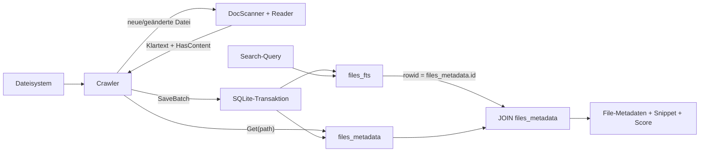

Das Diagramm zeigt die getrennte Speicherung: Metadaten sind keine
Volltextspalten, und der extrahierte Dokumenttext wird nicht als normale
Spalte von `files_metadata` zurückgegeben. Der FTS-Eintrag enthält die
Verknüpfungskennung und den durchsuchbaren Text.

## Rolle der Datenbank

Der Crawler benötigt ein `DateiRepository`, um pro Datei den bisherigen
Indexstand abzurufen und neue oder geänderte Einträge zu speichern. SQLite
implementiert diese Schnittstelle dauerhaft:

```text
Dateisystem
    |
    v
Crawler -- Metadaten + Dateiinhalt --> DocScanner / Reader
    |
    v
SqliteDateiRepository
    +-- files_metadata  (Metadaten und Indexstatus)
    +-- files_fts       (Volltextindex des extrahierten Inhalts)
```

Das Repository wird mit einer konkreten Datenbankdatei geöffnet. Die
Initialisierung legt das übergeordnete Verzeichnis und bei Bedarf Datenbank
und Tabellen an. Für den grundlegenden Aufbau ist keine separate
Serverinstallation nötig.

## Entwicklungsschritte des Programms

Die Architektur hat sich in aufeinander aufbauenden Schritten entwickelt:

1. **Dateien erfassen:** Der Crawler durchläuft Verzeichnisse und bildet
   Dateimetadaten als `Datei`-Objekte ab.
2. **Inhalte extrahieren:** Der DocScanner wählt passende Reader aus und
   liefert Klartext für unterstützte Formate.
3. **Speicherung entkoppeln:** `DateiRepository` trennt den Scanablauf vom
   Speicher. Damit kann der Crawler mit einem In-Memory- oder einem
   persistenten Repository arbeiten.
4. **Persistenz und Volltextsuche:** `SqliteDateiRepository` speichert
   Metadaten in `files_metadata` und Dateinamen sowie extrahierten Text im
   separaten FTS5-Index.
5. **Schema:** Das Datenbankschema speichert Verzeichnis, Dateiname und Endung
   getrennt und verknüpft FTS-Einträge über interne IDs.
6. **Datenbankzugriffe bündeln und optimieren:** `GetMany()` lädt mehrere
   Metadatensätze pro Abfrage, `GetPathsUnder()` nutzt einen Verzeichnisindex,
   und `SaveBatch()` verwendet vorbereitete SQL-Befehle wieder.
7. **Löschungen bündeln:** `RemoveBatch()` löscht mehrere Metadatensätze und
   FTS-Einträge in einer Transaktion.

Die Optimierungen dieses letzten Schritts bleiben auf der
Repository-/Datenbankseite. Der Crawler selbst ist nicht Teil dieser Änderung.

### Bewertung der Schema-Migration

Eine automatische Migration des alten Metadatenschemas (`path`/`path_key`)
ist nicht nötig, wenn nur das aktuelle Schema verwendet wird. Sie wurde
entfernt; eine Datenbank mit diesem Altschema wird jetzt mit einer klaren
Fehlermeldung abgewiesen. Falls eine solche Datenbank doch noch gebraucht wird,
muss sie mit einer aktuellen Programmversion exportiert oder neu aufgebaut
werden.

Auch die automatische FTS-Migration wurde entfernt: Der verwendete Index liegt
bereits im aktuellen Schema. Falls doch eine ältere Datenbank ohne
Dateinamen-Spalte auftaucht, wird sie mit einer klaren Fehlermeldung
abgewiesen. Dann kann mit `-DatabasePath` ein neuer Index angelegt und der
Dateibaum neu gescannt werden; eine automatische Migration würde nur für
Altbestände benötigt, die weiterverwendet werden müssen.

## Voraussetzungen und Installation

- PowerShell 7.2 oder neuer
- Unterstütztes Windows, macOS oder Linux mit passender nativer SQLite-Laufzeit
- Beim ersten Einrichten Internetzugriff auf NuGet

`Initialize-Database` führt [Install-Sqlite.ps1](./src/Persistence/Install-Sqlite.ps1)
aus. Das Installationsskript lädt die benötigten .NET- und nativen
SQLitePCLRaw-/Microsoft.Data.Sqlite-Dateien herunter und legt sie standardmäßig
in `lib/sqlite/` ab. Ein Versionsmarker verhindert einen erneuten Download,
wenn Version und Plattform-Laufzeit bereits vorhanden sind. Die
SQLite-Datei selbst sollte an einem eigenen Pfad liegen, beispielsweise
`data/index.sqlite3`.

Der Ordner `lib/sqlite/` sowie SQLite-Datenbank-, Journal-, WAL- und
SHM-Dateien sind in [`.gitignore`](./.gitignore) ausgeschlossen. Die Datenbank
enthält sowohl Dateipfade als auch extrahierte Inhalte; sie sollte deshalb wie
ein lokaler Suchindex mit möglicherweise vertraulichen Daten behandelt werden.

## Scan und Suche starten

Der reguläre Einstiegspunkt scannt in SQLite und kann danach direkt suchen:

```powershell
pwsh -File ./suchmaschine.ps1 `
    -RootPath "$HOME/Documents" `
    -DatabasePath "./data/index.sqlite3" `
    -Query "Vorlesung"
```

Ohne `-Query` wird nur gescannt. Die getrennte Repository-API kann weiterhin
für eigene Skripte und Programme verwendet werden.

## Schema und gespeicherte Daten

### `files_metadata`

Enthält genau einen Eintrag je normalisiertem Dateipfad:

| Spalte | Bedeutung |
|---|---|
| `id` | Interner SQLite-Schlüssel. |
| `directory_path` | Normalisierter Pfad zum Ordner, ohne Dateinamen. |
| `filename` | Dateiname ohne Endung. |
| `extension` | Dateiendung separat und mit Originalschreibweise, inklusive Punkt. |
| `size_bytes` | Dateigröße in Bytes. |
| `creation_time_utc_ticks` | Erstellungszeit als .NET-UTC-Ticks. |
| `last_write_time_utc_ticks` | Änderungszeit als .NET-UTC-Ticks. |
| `indexed_at_utc_ticks` | Zeitpunkt der letzten Indexierung als .NET-UTC-Ticks. |
| `has_content` | Ob ein Reader den Inhalt gelesen hat. `$true` ist auch bei leerem extrahierten Text möglich. |
| `is_cloud_only` | Ob die Datei als Cloud-Platzhalter übersprungen wurde. |

Auf `extension` liegt ein case-insensitiver Index für Filterung nach
Dateiendung. Ein eindeutiger zusammengesetzter Index aus `directory_path`,
`filename` und `extension` verhindert doppelte Einträge.
Groß-/Kleinschreibung wird auf Windows und macOS ignoriert und unter Linux
unterschieden. Der vollständige Pfad wird beim Lesen aus diesen drei Werten
zusammengesetzt und nicht redundant gespeichert. Das Dateiobjekt normalisiert
die angezeigte Endung weiterhin zu Kleinbuchstaben.

Der zusammengesetzte Index unterstützt außerdem gezielte Abfragen nach
mehreren Dateipfaden. Auf Systemen mit case-sensitiven Pfaden gibt es zusätzlich
einen case-insensitiven Verzeichnisindex, den `GetPathsUnder()` für eine
kandidatenbasierte Präfixsuche nutzt; die abschließende Pfadprüfung beachtet
weiterhin die Plattformregeln.

### `files_fts`

Eine virtuelle FTS5-Tabelle speichert `file_id`, `filename` und den
extrahierten `content`. `file_id` ist `UNINDEXED`: Er dient der Verknüpfung,
nicht der Textsuche. Dateinamen enthalten die Endung und werden für alle
Dateien indiziert, auch wenn kein Reader den Inhalt lesen konnte. Der
extrahierte Text wird nur bei `has_content = true` eingetragen. Beide
Textspalten nutzen SQLite FTS5 mit dem Tokenizer
`unicode61 remove_diacritics 2`, der Unicode normalisiert und diakritische
Zeichen bei der Suche entfernt.

Der extrahierte Text wird **nicht** in `files_metadata` abgelegt. Das normale
`Get(path)` gibt nur Metadaten zurück; die Volltextsuche verwendet den
separaten FTS-Index. Wird eine Datei erneut gespeichert, ersetzt das
Repository ihren FTS-Eintrag, damit weder alte Dateinamen noch alter Text als
Treffer erhalten bleiben. Bei `has_content = false` enthält der FTS-Eintrag
einen leeren Inhalt, aber weiterhin den Dateinamen.

Die Tabellen sind über den internen Primärschlüssel `files_metadata.id` und
`files_fts.file_id` verknüpft. Deshalb aktualisieren `Remove()` und
`SaveWithinTransaction()` beide Seiten gemeinsam innerhalb einer Transaktion.
Der FTS-Index speichert keinen zweiten Dateipfad; der Dateiname ist dort
zusätzlich enthalten, damit er direkt durchsuchbar ist.

Beim Öffnen werden das aktuelle Metadatenschema und die FTS-Spalte `filename`
vorausgesetzt. Ältere Datenbanken mit `path`/`path_key` oder ohne
Dateinamen-Spalte werden nicht automatisch migriert. Sie führen zu einer
Fehlermeldung mit dem Hinweis, eine neue Datenbank anzulegen und erneut zu
scannen. Neue Datenbanken werden direkt mit dem aktuellen Schema erstellt.

Zeitwerte sind UTC-Ticks aus `.NET DateTime`; sie werden beim Lesen wieder als
UTC-Datumswerte rekonstruiert. Dadurch bleibt die Genauigkeit des Zeitstempels
beim Vergleich erhalten.

### Was beim Speichern passiert

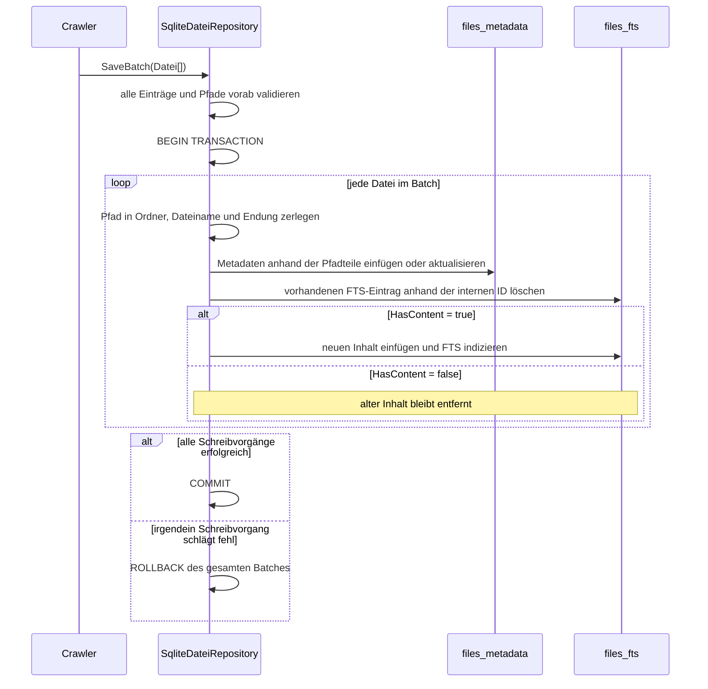

Das Repository zerlegt den normalisierten Pfad und fügt den Metadatensatz ein
oder aktualisiert ihn anhand des eindeutigen Indexes. Das Upsert liefert die
interne ID direkt zurück. Anschließend wird der zugehörige FTS-Eintrag
ersetzt. Beide Schritte sind derselben Transaktion zugeordnet.

Werte werden über benannte Parameter (zum Beispiel
`$directoryParameter`, `$filenameParameter` und `$contentParameter`) übergeben
und nicht in den SQL-Text eingesetzt. Das gilt für Pfade, Dateinamen, Inhalte
und Suchtext. Die Abfrage selbst bleibt dadurch von den Datenwerten getrennt.

## Lese- und Scanverhalten

- `Save(file)` speichert eine Datei über dieselbe Batch-Logik wie `SaveBatch`.
- `SaveBatch(files)` schreibt Metadaten und FTS-Einträge innerhalb **einer
  Transaktion**. Bei einem Fehler wird der ganze Batch zurückgerollt.
- `GetMany(paths)` lädt bekannte Metadatensätze mit einer gemeinsamen
  SQL-Abfrage je höchstens 300 Pfade. Das vermeidet einen Datenbank-Roundtrip
  pro Datei; fehlende Pfade sind nicht im Ergebnis enthalten.
- `Sync-Files` verwendet `GetMany()` vor dem Vergleich der Änderungszeiten und
  speichert danach nur neue oder geänderte Dateien.
- Ein vorhandener Pfad wird aktualisiert statt dupliziert.
- Beim Aktualisieren wird zunächst der bisherige FTS-Eintrag entfernt und
  danach der Dateiname und - sofern `HasContent` gesetzt ist - der neue Inhalt
  indiziert.
- `Remove(path)` entfernt Metadaten und Volltextindex-Eintrag atomar.
- `GetPathsUnder(folder)` liefert gespeicherte Pfade im Ordnerbaum. Der
  Crawler nutzt dies zur Lösch-Erkennung.
- Unveränderte Dateien werden vom Crawler nicht erneut gelesen oder gespeichert.
  Entscheidend ist dabei `LastWriteTimeUtc`; Dateigröße und Inhalt werden nicht
  zusätzlich verglichen.
- Beim Schreiben bereitet `SaveBatch()` die Metadaten-, FTS-Lösch- und
  FTS-Einfüge-Befehle einmal pro Transaktion vor und verwendet dieselben
  Befehle mit aktualisierten Parametern für jede Datei wieder.
- `RemoveBatch(paths)` entfernt Metadaten und FTS-Einträge in einer
  gemeinsamen Transaktion. Die Pfade werden validiert und normalisiert; doppelte
  Pfade werden übersprungen. SQL-Parameter werden in Gruppen von höchstens 300
  Pfaden gebunden.
- `Remove(path)` delegiert an `RemoveBatch()` und behält damit dasselbe
  transaktionale Verhalten für Einzellöschungen.
- Der Crawler schreibt standardmäßig in Batches von 200 Dateien
  (`SaveBatchSize`). Ein fehlgeschlagener Batch wird als Repository-Fehler
  gemeldet.

Bei einem Ordnerscan werden gespeicherte Pfade unter dem Scan-Ordner, die
weder gefunden noch unter einem nicht lesbaren Ordner liegen, aus der
Datenbank entfernt. Ein einzelner Dateiaufruf über `ProcessFile()` führt
keine Lösch-Erkennung durch.

`GetPathsUnder()` fragt zuerst nur Datensätze ab, deren Verzeichnis exakt dem
Scan-Root entspricht oder mit dem Root plus Pfadtrenner beginnt. SQLite nutzt
dabei einen Verzeichnisindex und escaped `%`, `_` sowie `\` im Rootpfad, damit
Dateinamen mit diesen Zeichen nicht als SQL-Wildcards interpretiert werden.
Die Kandidaten werden anschließend weiterhin mit
`PathUtil.IsSameOrUnder()` geprüft. So bleibt die Prüfung der Ordnergrenze und
der Plattform-spezifischen Groß-/Kleinschreibung maßgeblich.

Die `GetMany()`-Methode steht im Repository-Vertrag zur Verfügung und ist
bereits in `Sync-Files` eingebunden. Der Crawler ruft derzeit jedoch für jede
Datei einzeln `Get(path)` auf. Er wurde hier bewusst nicht geändert; der
laufende Crawler-Scan erhält den Vorteil der gebündelten Leseabfrage daher erst,
wenn seine Seite des Repository-Vertrags später `GetMany()` aufruft.

### Entwicklungsschritt: gebündelte Löschungen und Migration

Die folgenden Schritte erweitern die Optimierungen auf der Persistence-Seite,
ohne den Crawler oder die GUI zu ändern:

1. `RemoveBatch(paths)` validiert und normalisiert alle Pfade vor dem
   Schreibvorgang. Doppelte Pfade werden anhand der plattformspezifischen
   Pfadvergleichsregeln nur einmal verarbeitet.
2. Die Pfade werden in Gruppen von höchstens 300 verarbeitet. Je Gruppe löscht
   eine SQL-Abfrage die passenden FTS-Einträge und eine weitere die
   Metadatensätze. Die Gruppierung hält die Parameterzahl unter dem klassischen
   SQLite-Limit von 999 Variablen.
3. Alle Gruppen eines `RemoveBatch()`-Aufrufs laufen in einer gemeinsamen
   SQLite-Transaktion. Bei einem Fehler wird der gesamte Aufruf zurückgerollt;
   dadurch bleiben FTS-Index und Metadaten synchron.
4. `Remove(path)` verwendet denselben Codepfad mit genau einem Pfad. Die
   Standardimplementierung des Repository-Vertrags bleibt kompatibel und
   entfernt Pfade einzeln; SQLite überschreibt `RemoveBatch()` für die
   gebündelte Variante.
5. Damit ein Scan von den gebündelten Löschungen profitiert, muss der Crawler
   künftig seine einzelnen `Remove()`-Aufrufe an geeigneten Stellen durch
   Aufrufe von `RemoveBatch()` ersetzen. Diese Integration liegt außerhalb
   dieses Entwicklungsschritts; entsprechend bleiben auch die
   Einzel-Lookups `Repository.Get(path)` im Crawler bestehen.

### Batchgröße messen

`SaveBatch()` verarbeitet alle übergebenen Dateien in einer Transaktion und
verwendet vorbereitete Befehle. Die Batchgröße selbst bestimmt weiterhin der
aufrufende Scanprozess; der aktuelle Crawler-Standard ist 200 Dateien. Für eine
fundierte Abstimmung sollten vollständige, repräsentative Scans mit mehreren
Werten (zum Beispiel 100, 200 und 500 Dateien pro Batch) auf demselben
Dateibaum und derselben Datenbank gemessen werden. Neben der Gesamtdauer auch
Anzahl und Dauer fehlgeschlagener Batches sowie den Speicherbedarf vergleichen.
Den Crawler und seine Batch-Konfiguration habe ich nicht geändert.

### Benchmark für Programmabläufe

Das separate Skript
[Measure-Performance.ps1](./tests/Measure-Performance.ps1) misst die Laufzeiten
von Crawler, DocScanner und Datenbank, ohne Dateien im Scan-Root zu verändern.
Es ist ein Benchmark und kein Pester-Test; `Invoke-Pester` führt es nicht
automatisch aus.

```powershell
pwsh -File ./tests/Measure-Performance.ps1 `
    -RootPath "$HOME/Documents" `
    -Iterations 100 `
    -WarmupRuns 3 `
    -SaveBatchSize 200 `
    -SearchQuery "Vorlesung" `
    -CsvPath "$HOME/performance-results.csv"
```

Jede Iteration erstellt eine frische temporäre Datenbank und misst denselben
Ablauf in zwei Zuständen:

1. **Leere Datenbank:** Initialisierung und Datenbankoperationen auf leerem
   Index, danach der erste Scan, der alle Dateien verarbeitet und einträgt.
2. **Gefüllte Datenbank:** Datenbank erneut öffnen/initialisieren, dann der
   direkte zweite Scan desselben Bestands sowie Datenbankoperationen auf dem
   vorhandenen Index. Unveränderte Dateien sollten nicht erneut gelesen oder
   gespeichert werden.

In beiden Zuständen werden `GetPathsUnder()`, `Search-Query`, `GetMany()` und
`RemoveBatch()` separat gemessen. Beim leeren Index sind Suchtreffer und
bearbeitete Pfade erwartungsgemäß null; diese Werte dienen als Vergleich für
den gefüllten Index. Der Scan wird außerdem in Gesamtlaufzeit, Repository-
`Get`, `SaveBatch`, `Remove`, `GetPathsUnder`, `DocScanner.ReadContent()` und
übrige Crawler-Arbeit zerlegt. Auch Komponenten ohne Aufruf im gefüllten
Zustand werden mit null Aufrufen protokolliert.

`Iterations` ist die Anzahl der Messpaare. Jedes Szenario und jede Komponente
wird somit `Iterations`-mal gemessen; `WarmupRuns` wiederholt denselben Ablauf,
geht aber nicht in die Ergebnisse ein. Die Datenbank- und Suchmessungen zählen
nicht zur Crawler-Laufzeit. Die Suchzeit umfasst den Aufruf bis zu den
Ergebnissen, nicht deren Konsolenausgabe. Am Ende jeder Iteration wird die
temporäre Datenbank geleert beziehungsweise entfernt.

Die Konsole zeigt je Komponente und Datenbankzustand die Anzahl der Läufe,
Median, P95 sowie durchschnittliche Aufruf- und Elementzahlen je Lauf. Die CSV
enthält eine Zeile pro Messpunkt und Iteration und eignet sich für die
Detailanalyse; Laufzeiten verwenden unabhängig von der System-Locale einen
Dezimalpunkt. Die CSV enthält alle oben genannten Scan-Phasen und
SQLite-Operationen.

Die CSV wird standardmäßig im temporären Verzeichnis angelegt; `-CsvPath` legt
den gewünschten dauerhaften Speicherort fest. Das Skript verwendet eine
isolierte temporäre SQLite-Datenbank und entfernt sie nach Abschluss. Der
Scan-Root wird nur gelesen. Die Messwerte hängen dennoch von Dateisystem- und
SQLite-Caches, Datenträger, Dateitypen und externen Reader-Tools ab. Die
Datenbank wird für jede Iteration frisch erstellt; PowerShell-Prozessstart und
Modulladen sind nicht enthalten, und der Betriebssystem-Cache wird nicht
geleert. `-SearchQuery` sollte für eine repräsentative Suchmessung einen im
Bestand häufig vorkommenden Suchbegriff enthalten. Für Vergleiche deshalb
denselben Bestand, dieselbe
PowerShell-/SQLite-Version und dieselben Parameter verwenden.

## Volltextsuche

```powershell
Search-Query -Database $database -Query "vorlesung"
Search-Query -Database $database -Query '"lineare algebra"' -Limit 20
Search-Query -Database $database -Query "skript" -Extension ".pdf"
Search-Query -Database $database -Query "skript" -SearchMode FileName
Search-Query -Database $database -Query "skript" -SearchMode Content
Search-Query -Database $database -Query "skript" -SearchMode Both
```

Parameter:

- `Query`: FTS5-Suchausdruck. Ein leerer Ausdruck liefert keine Treffer.
- `Limit`: Höchstens 1 bis 1000 Ergebnisse; Standard ist 100.
- `Extension`: Optionaler Dateiendungsfilter. Ein fehlender Punkt wird
  ergänzt und die Eingabe kleingeschrieben.
- `SearchMode`: `FileName`, `Content` oder `Both`; Standard ist `Both`.
  Dateinamen werden auch dann indexiert, wenn kein Reader den Dateiinhalt
  extrahieren konnte. Der Dateiendungsfilter funktioniert in allen Modi.

Jedes Ergebnis enthält `File` (Dateimetadaten ohne Inhalt), `Snippet` und
`Score`. Der Ausschnitt markiert den Treffer mit eckigen Klammern; ausgelassene
Textbereiche werden mit `...` angezeigt. Der Score ist der negative
BM25-Rangwert, damit ein höherer Score bessere Treffer bezeichnet.

### Was die Suche in SQL tut

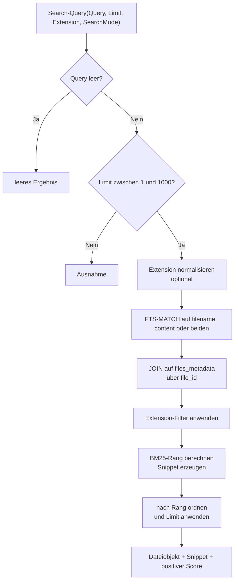

`MATCH` interpretiert die Eingabe als FTS5-Abfragesyntax, nicht als
unspezifische Teilzeichenkette. Ein Ausdruck mit Anführungszeichen sucht zum
Beispiel eine Phrase; FTS5-Operatoren und -Syntax werden ebenfalls
interpretiert. Ein syntaktisch ungültiger FTS-Ausdruck kann eine SQLite-
Ausnahme auslösen und wird nicht in „keine Treffer“ umgewandelt. Die
SQL-Abfrage verwendet `bm25(files_fts)` für die Relevanz und erzeugt den
Snippet aus der Spalte, in der der Treffer gefunden wurde. In
`files_fts(file_id, filename, content)` sind die FTS-Spaltennummern `1` für
den Dateinamen und `2` für den Inhalt; `file_id` (Spalte `0`) ist nicht
indiziert.
SQLite ordnet `rank` aufsteigend, weil bei BM25 kleinere Werte relevanter
sind. Die PowerShell-Schicht gibt `-rank` zurück, so dass dort ein größerer
`Score` für einen besseren Treffer steht.

Ein Erweiterungsfilter wird getrennt als Parameter gebunden. Ein `NULL`-Wert
schaltet den Filter aus; andernfalls muss die Dateiendung exakt mit dem
normalisierten Endungswert übereinstimmen.

## SQLite-Betrieb

Beim Öffnen der Datenbank setzt das Repository:

- `foreign_keys = ON`
- `journal_mode = WAL`
- `synchronous = NORMAL`
- `busy_timeout = 10000` Millisekunden

WAL kann neben der Hauptdatei `-wal`- und `-shm`-Begleitdateien erzeugen.
Datenbank und Begleitdateien nicht löschen, solange die Verbindung offen ist.
Vor dem Sichern oder Verschieben die Instanz mit `Dispose()` schließen.

Die Implementierung nutzt parameterisierte SQL-Befehle für Werte und führt
Schema-Erstellung beim Öffnen aus. `Initialize-Database` erstellt standardmäßig
die erforderliche Ordnerstruktur der Datenbankdatei.

## Öffentliche Befehle

Das Modul exportiert diese Funktionen:

| Befehl | Zweck |
|---|---|
| `Initialize-Database` | Laufzeit einrichten, Datenbank öffnen und Schema sicherstellen. Parameter: `DatabasePath`, optional `AssemblyPath`. |
| `Add-File` | Eine Datei speichern. |
| `Sync-Files` | Eine Sammlung anhand der Änderungszeit als hinzugefügt, aktualisiert oder unverändert synchronisieren. Gibt die Zähler `Added`, `Updated` und `Unchanged` zurück; löscht keine fehlenden Dateien. |
| `Search-Query` | Volltextsuche mit optionalem Limit und Dateiendungsfilter ausführen. |

## Begrenzter Verbindungspool für eigene Worker

`Initialize-DatabasePool -DatabasePath ./data/index.sqlite3 -PoolSize 4` öffnet
1 bis 1024 Verbindungen **seriell** einschließlich Schema/Migration und
Verbindungseinstellungen. Erst nach erfolgreichem Aufbau darf der zurückgegebene
C#-Pool mit Thread-Runspaces geteilt werden. Bei einem Aufbaufehler werden bereits
geöffnete Verbindungen geschlossen. Microsoft.Data.Sqlite-Provider-Pooling bleibt
`Pooling=False`; der eigene Pool hält genau `PoolSize` offene Verbindungen und
öffnet beim Ausleihen keine weiteren. Bestehende Repository-Konstruktoren und
Funktionen bleiben unverändert nutzbar. Der Crawler wird nicht umgestellt.

### Worker-Vertrag und API

PowerShell-Klassen haben unter PowerShell 7.2 Runspace-Affinität. Deshalb **keine
im Eltern-Runspace erzeugten Repository-/Datei-Instanzen oder PowerShell-Callbacks
an Worker übergeben**. Nur der C#-Pool und bei Bedarf .NET-Synchronisationsobjekte
werden per Referenz geteilt (keine Remote-/Prozessjobs mit Serialisierung).
Jeder Worker lädt die Module und erzeugt seinen Adapter und seine `Datei`-Objekte
selbst. Der Adapter um die Lease führt keine Schema-Initialisierung aus:

```powershell
# Am Anfang einer Worker-Skriptdatei (Pfade passend zur Datei wählen):
using module ./src/Model/Datei.psm1
using module ./src/Persistence/SqliteDateiRepository.psm1
param($Pool)

$lease = $Pool.Borrow(5000)
$repository = $null
try {
    $repository = [SqliteDateiRepository]::new($lease)
    # Datei hier im Worker erzeugen; vorhandene Repository-API verwenden.
    $paths = $repository.GetPathsUnder('/data/documents')
}
finally {
    if ($null -ne $repository) { $repository.Dispose() }
    $lease.Dispose() # auch bei fehlgeschlagenem Adapter-Konstruktor
}
```

Ein ausführbares Hosted-Runspace-Beispiel steht in
`tests/fixtures/DatabasePoolWorker.ps1` und `tests/DatabasePool.Tests.ps1`.
Ein einzelner Adapter bzw. eine Lease gehört immer **einem** Worker; nicht selbst
parallel benutzen, freigeben oder schließen, während dessen Methoden laufen.
Die rohe `Connection` ist nur für kontrollierte Diagnose innerhalb derselben
Lease gedacht: niemals separat schließen, weiterreichen, oder nach Rückgabe
weiterverwenden. Reader/Kommandos/Transaktionen vor Rückgabe freigeben; die
Repository-Methoden erledigen dies mit `finally`.

| API | Vertrag |
|---|---|
| `Borrow(int timeoutMilliseconds)` | Nichtnegativer Wert; `0` ist ein sofortiger Versuch. Wartet höchstens diese Zeit auf eine freie Verbindung, sonst `TimeoutException`. Kein unendliches Warten. |
| `Capacity`, `AvailableCount`, `WaitingCount`, `Id`, `IsDisposed` | Kapazität, momentane Diagnosewerte und stabile Poolidentität; Zähler sind keine Reservierung. Wartende erhalten keine FIFO-Garantie. |
| Lease: `PoolId`, `Connection`, `IsReturned` | Identität und exklusive Verbindung während der Leihdauer. Nach Rückgabe wirft `Connection` eine Ausnahme. |
| `[SqliteDateiRepository]::new($lease)` | Genau ein Worker-lokaler Adapter je Lease; ein zweiter Adapter wird abgelehnt. |
| Adapter-`Dispose()` / Lease-`Dispose()` | Gibt die Verbindung exakt einmal zurück; wiederholtes Dispose ist wirkungslos. Nach direkter Lease-Rückgabe ist auch ein noch vorhandener Adapter ungültig, selbst nach erneuter Ausleihe derselben Verbindung. |
| Pool-`Dispose()` | Idempotent: sperrt neue Ausleihen, weckt Wartende mit `ObjectDisposedException` und schließt freie Verbindungen. Noch ausgeliehene Verbindungen bleiben bis zur Rückgabe nutzbar und werden dann geschlossen, nicht wieder eingereiht. |

Pool-Dispose wartet nicht auf Worker. Vor Löschen/Verschieben/Sichern der Datenbank
alle Worker beenden und **alle** Leases zurückgeben; verlorene Leases werden nicht
per Finalizer zurückgeholt. Pool-Dispose ist keine Abbruchfunktion für laufende
SQL-Kommandos. Der Borrow-Timeout betrifft nur die Pool-Warteschlange und ist
unabhängig vom SQLite-Busy-/Command-Timeout (Microsoft.Data.Sqlite verwendet für
Kommandos standardmäßig 30 Sekunden; `busy_timeout=10000` wird wie bisher gesetzt).
WAL erlaubt überlappende Leser; SQLite serialisiert weiterhin Schreibtransaktionen.
Ein Pool erhöht also nicht die Anzahl gleichzeitiger SQLite-Schreiber.

### Reproduzierbarer Pool-Benchmark

```powershell
pwsh -NoProfile -File ./tests/Measure-DatabasePool.ps1 `
    -Repetitions 10 -WarmupRuns 2 -Operations 500
# Oder die Ergebnisobjekte in einem PowerShell-Aufruf nach CSV exportieren:
./tests/Measure-DatabasePool.ps1 | Export-Csv ./pool-results.csv -NoTypeInformation
```

Beide Modi führen dasselbe `SELECT COUNT(*) FROM files_metadata` in einer isolierten
lokalen Datenbank aus. `Pooled` leiht eine bereits offene Verbindung aus;
`RepeatedOpen` erzeugt/öffnet/schließt je Operation eine neue Verbindung mit exakt
demselben Connection-String und deaktiviertem Provider-Pooling. Schemaaufbau und
Pool-Erstellung liegen außerhalb der Messung; es werden keine Schemaarbeiten je
Operation und keine Crawler-/Adapter-Laufzeiten gemessen. Die Reihenfolge wechselt
pro Wiederholung. Warm-ups werden verworfen; jede Ergebniszeile enthält Parameter,
Versionen, Laufzeit und Durchsatz (Operationen/Sekunde). Datenträger-/OS-Caches
bleiben warm. Dies ist ein serieller Open/Reuse-Mikrobenchmark, kein Nachweis höherer
paralleler Schreibleistung. Gleiche Umgebung/Parameter verwenden; keine fragile
Mindestbeschleunigung im Test erzwingen. Der Benchmark ist kein Pester-Test.

## Tests

```powershell
Invoke-Pester -Path ./tests
```

CI entdeckt rekursiv alle `*.Tests.ps1`. Die Pooltests verwenden echte Runspaces,
eine gemeinsame Poolreferenz, Countdown/Gates und begrenzte Wartezeiten. Sie prüfen
überlappende Leases vor Öffnen des Gates, exklusive Verbindungen, Wiederverwendung,
Metadaten/FTS nach parallelen Updates/Löschungen, Timeout, wartende Ausleiher,
Rückgabe nach Fehlern sowie Shutdown mit ausstehenden Leases.

Die Tests legen temporäre Datenbanken an und prüfen unter anderem Transaktionen
und Rollbacks, Suche und Snippets, Endungsfilter, Synchronisierung,
gebündelte Lookups über Batchgrenzen, Ordnerpfade mit SQL-Wildcards,
Persistenz nach erneutem Öffnen und Verhalten nach `Dispose()`.

## Initialisierung und Verbindung Schritt für Schritt

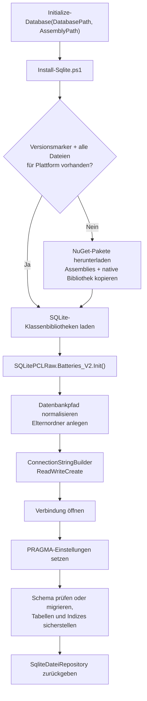

`SqliteProvider.Load()` lädt die verwalteten Assemblies per Reflection aus
`AssemblyPath`, damit der Code beim Parsen nicht zwingend eine bereits im
System installierte `Microsoft.Data.Sqlite`-Assembly voraussetzt. Danach
initialisiert `Batteries_V2` den nativen SQLite-Provider. Bei fehlenden
Assemblies oder einer nicht unterstützten Plattform wird eine Ausnahme
ausgelöst, anstatt eine scheinbar erfolgreiche, aber nicht verbundene
Repository-Instanz zurückzugeben.

Der Konstruktor erstellt mit `ReadWriteCreate` eine neue Datenbankdatei, wenn
sie noch nicht existiert. Nach dem Öffnen ruft er `InitializeSchema()` auf.
Die Schema-Initialisierung ist wiederholbar. Sie setzt das aktuelle
Metadatenschema und die aktuelle FTS-Tabelle voraus und weist ältere
Datenbanken mit einer Fehlermeldung ab. Für einen Altindex kann ein neuer
Datenbankpfad angegeben und der Ordner erneut gescannt werden.

## Repository-Methoden und ihre Datenbankwirkung

| Methode | Datenbankarbeit | Ergebnis / wichtige Eigenschaft |
|---|---|---|
| `Get(path)` | `SELECT` aus `files_metadata` anhand der normalisierten Pfadteile. | Gibt `null` zurück, wenn der Pfad unbekannt ist. Gibt keinen Inhalt zurück und liest nicht aus FTS. |
| `GetMany(paths)` | Je höchstens 300 Pfade eine `VALUES`-CTE mit Join auf den zusammengesetzten Pfadindex. | Gibt ein Dictionary vorhandener Dateien zurück; fehlende Pfade fehlen. |
| `Save(file)` | Delegiert an `SaveBatch()` mit genau einem Eintrag. | Einzelschreiben erhalten dieselben Validierungs- und Transaktionseigenschaften. |
| `SaveBatch(files)` | Validiert Pfade vorab, beginnt Transaktion und verwendet vorbereitete Metadaten- und FTS-Befehle für alle Einträge erneut. | Alles oder nichts für den Batch. Leere Batches sind No-op. |
| `SaveWithinTransaction(file)` | Upsert der Metadaten, Löschen des alten FTS-Satzes, Einfügen des Dateinamens und optional des neuen Texts über die vorbereiteten Befehle. | Der Dateiname wird immer indiziert; der Inhalt nur bei `HasContent = true`. |
| `Remove(path)` | Delegiert an `RemoveBatch()` mit genau einem Pfad. | Verhindert verwaiste Treffer oder Metadatensätze, solange der Vorgang erfolgreich ist. |
| `RemoveBatch(paths)` | Löscht je höchstens 300 Pfade pro SQL-Gruppe aus FTS und Metadaten; alle Gruppen teilen sich eine Transaktion. | Validiert vorab, ignoriert doppelte normalisierte Pfade und rollt bei Fehlern den gesamten Aufruf zurück. |
| `GetPathsUnder(folder)` | Indizierte Suche nach identischem Verzeichnis oder passendem Verzeichnispräfix; Kandidaten werden mit `PathUtil` exakt geprüft. | Gibt die Kandidaten für die Lösch-Erkennung zurück, ohne alle Metadaten zu lesen. |
| `Search(query, limit, extension, searchMode)` | FTS5-`MATCH` auf Dateiname, Inhalt oder beides; Join auf Metadaten, optionaler Endungsfilter, Rang, Snippet und Limit. | Gibt Objekte mit `File`, `Snippet`, `Score` zurück. |
| `Dispose()` | Schließt die SQLite-Verbindung einmalig. | Nach `Dispose()` weisen Repository-Methoden mit `EnsureOpen()` auf die ungültige Verwendung hin. |

Die SQL-Kommandos, Reader, Transaktionen und Verbindungen werden im Code
jeweils mit `finally`/`Dispose()` freigegeben. Ein Fehler während des
Konstruktor-Aufbaus schließt die Verbindung, bevor er weitergeworfen wird.

## Sequenzdiagramme der Grundfunktionen

Die Diagramme zeigen die zentralen Abläufe aus Sicht der Nutzung. Interne
Hilfsmethoden wie `NewCommand()`, `ReadDatei()` und `EnsureOpen()` sind in den
Abläufen zusammengefasst, statt jeweils ein eigenes Diagramm zu erhalten.

### SQLite-Laufzeit und Datenbank initialisieren

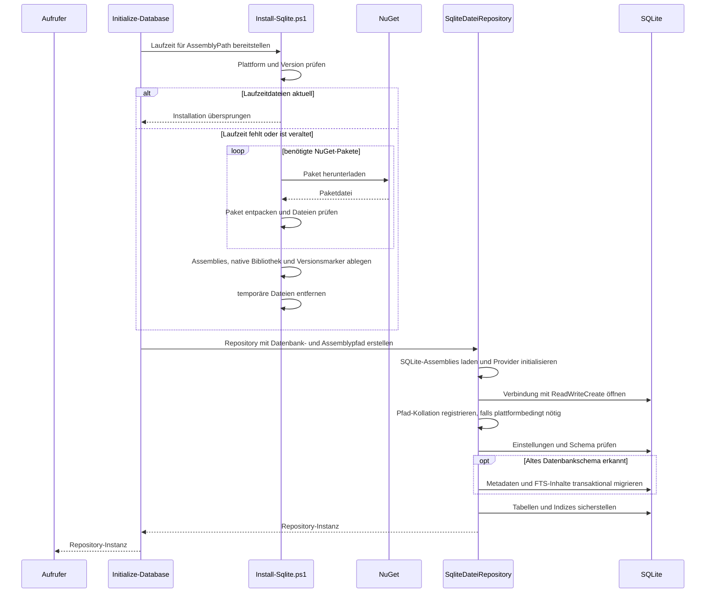

Das Installationsskript lädt die plattformspezifischen verwalteten und nativen
SQLite-Dateien nur dann, wenn Laufzeitversion oder Dateien nicht bereits
passen. Fehler während der Installation oder Initialisierung werden
weitergegeben; der Konstruktor schließt bei einem Fehler die Verbindung.

### Datei-Metadaten abrufen

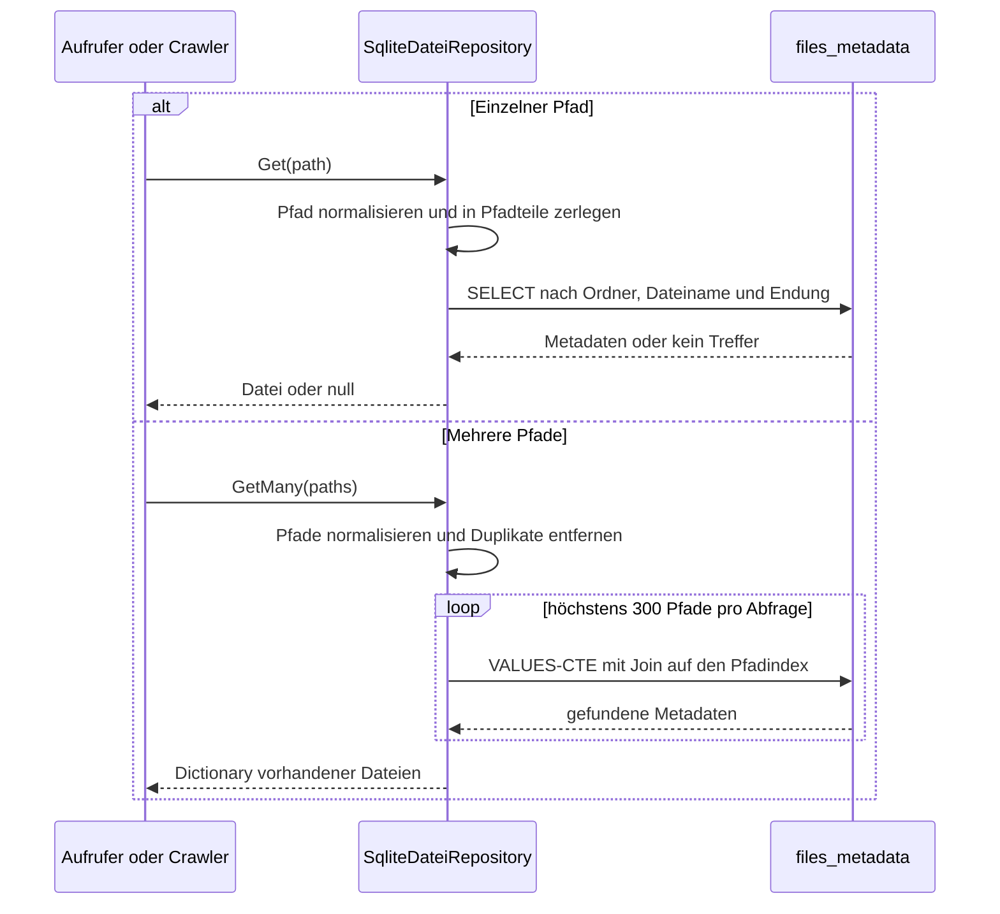

Beide Abfragen liefern Metadaten, nicht den indizierten Dokumenttext. Pfad-
und Dateischreibweisen werden entsprechend den Plattformregeln verglichen.

### Dateien speichern und Volltextindex aktualisieren

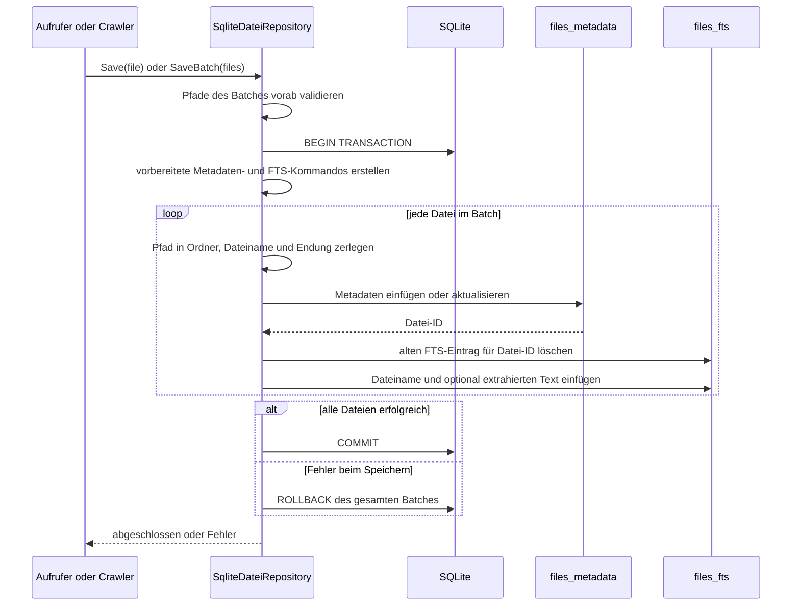

`Save(file)` verwendet denselben Ablauf wie `SaveBatch()` mit genau einer
Datei. Metadaten und Volltext werden atomar aktualisiert; bei Dateien ohne
Inhalt wird der Dateiname im FTS-Index gespeichert, der Inhalt bleibt leer.

### Dateien aus dem Index entfernen

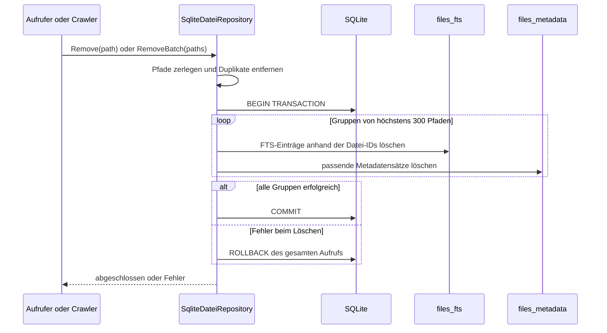

`Remove(path)` delegiert an `RemoveBatch()` mit einem Pfad. Die gemeinsame
Transaktion verhindert verwaiste Metadaten oder FTS-Treffer.

### Dateien unter einem Ordner ermitteln

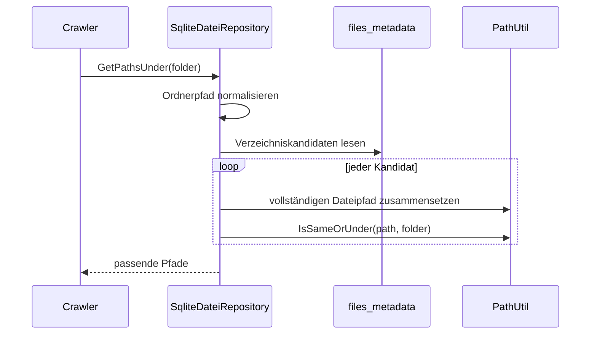

Der abschließende Pfadvergleich verhindert, dass Ordner mit nur gemeinsamem
Namenspräfix fälschlich als Unterordner gelten.

### Dateien synchronisieren

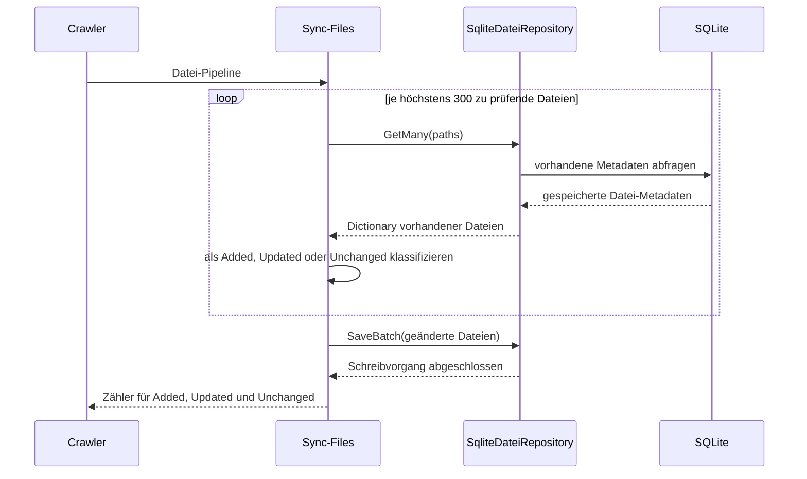

Unveränderte Dateien werden nicht erneut gespeichert. `Sync-Files()` löscht
keine Dateien, die im aktuellen Scan fehlen.

### Volltextsuche ausführen

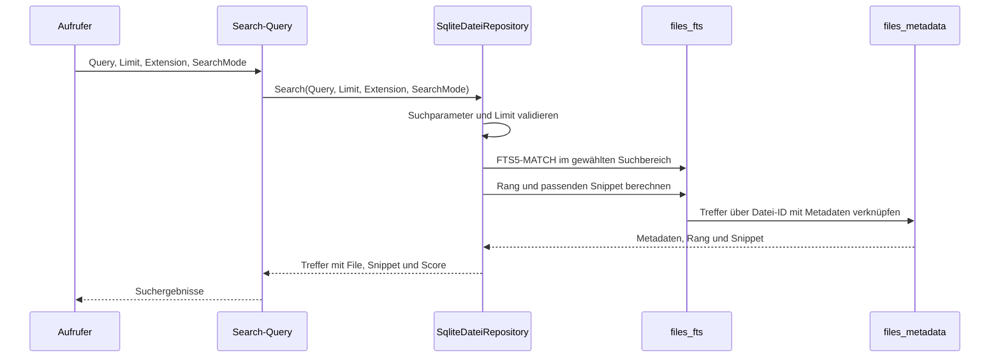

Ein leerer Suchtext liefert keine Treffer. Das Limit ist auf 1 bis 1000
begrenzt; der Dateiendungsfilter ist optional. `SearchMode` ist `FileName`,
`Content` oder `Both` und standardmäßig `Both`.

### Datenbankverbindung schließen

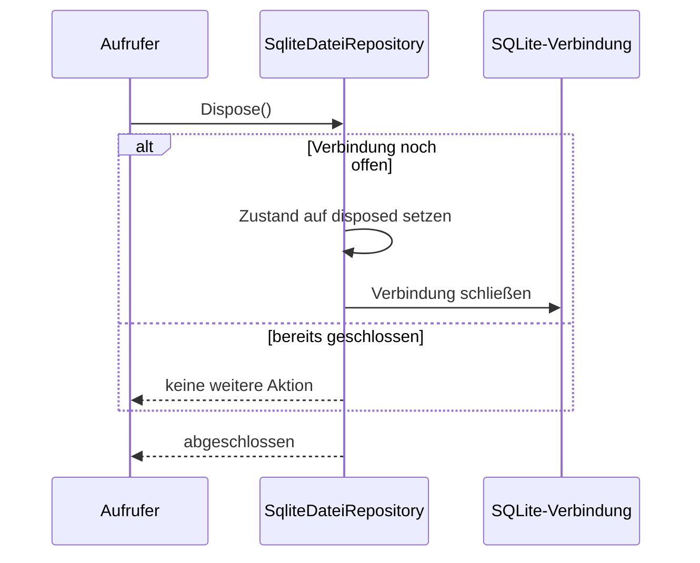

Der Fehler `ParentContainsErrorRecordException: Cannot find an overload for
"CreateCollation" and the argument count: "2"` kam von einer früheren
Implementierung, die beim Öffnen der Verbindung eine benutzerdefinierte
Collation mit einem für `Microsoft.Data.Sqlite` inkompatiblen Delegate-Typ
registrierte. Die aktuelle Implementierung ruft `CreateCollation` nicht mehr
auf und verwendet unter Windows/macOS SQLite-`NOCASE`, unter Linux `BINARY`.
SQLite-`NOCASE` faltet nur ASCII-Buchstaben; nicht-ASCII-Pfadzeichen werden
daher nicht vollständig wie bei .NET `OrdinalIgnoreCase` verglichen.

Wenn der Fehler trotz aktuellem Quellstand weiter erscheint, läuft
wahrscheinlich noch eine PowerShell-Sitzung mit dem zuvor importierten
Modulcode. Die Sitzung vollständig beenden und neu starten, damit die
aktuelle Repository-Klasse geladen wird.

## Zeitstempel, Status und Neustart

SQLite speichert `CreationTimeUtc`, `LastWriteTimeUtc` und `IndexedAtUtc`
jeweils als `.Ticks`. Das sind 100-Nanosekunden-Einheiten seit dem
.NET-Zeitursprung 0001-01-01, keine Unix-Zeit und keine lokalen Zeitstrings. `ReadDatei()`
rekonstruiert daraus `DateTime` mit `DateTimeKind.Utc`.

Der im laufenden Scan gesetzte `DateiStatus` wird nicht gespeichert. Beim
nächsten Scan leitet der Crawler `New`, `Changed` oder `Unchanged` wieder aus
dem Vorhandensein des Pfads und dem Änderungszeitstempel ab. Nach einem
PowerShell-Neustart bleiben Metadaten und FTS-Texte in der SQLite-Datei
erhalten; der Crawler kann daher unveränderte Dateien überspringen und eine
Suche ausführen, ohne die Reader erneut laufen zu lassen.

Wird dagegen eine Datenbankdatei gelöscht oder ein anderer Pfad beim Start
angegeben, existiert dort kein vorheriger Indexstand. Der nächste Scan
behandelt die gefundenen Dateien entsprechend als neu.
