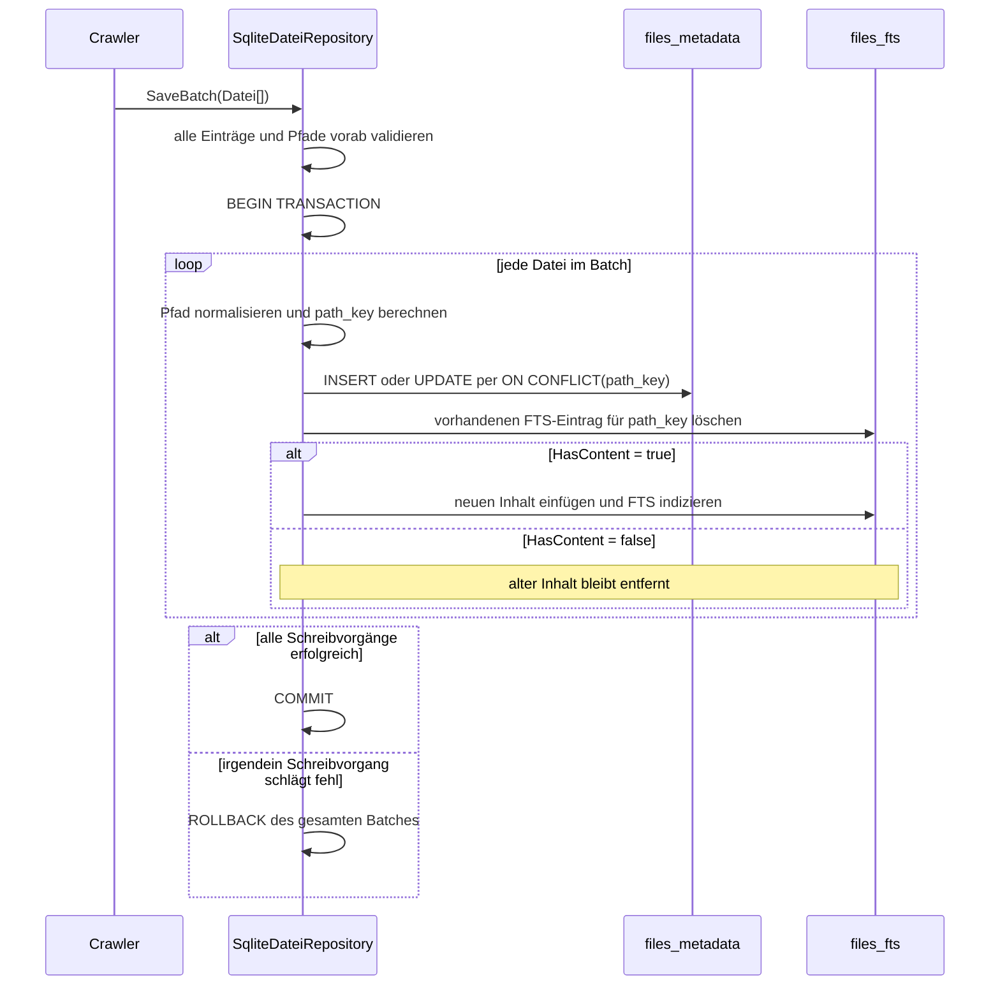
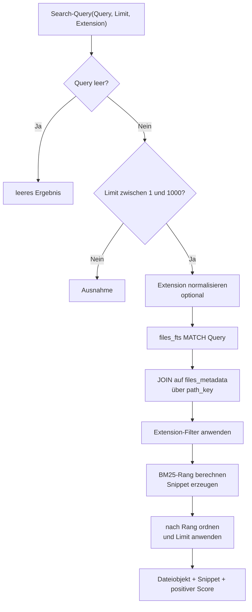
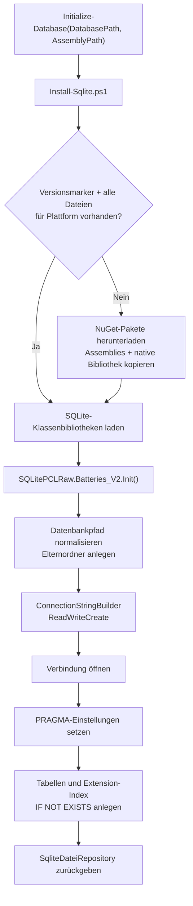

# SQLite-Datenbank

Diese Datei beschreibt die persistente Speicherung und Volltextsuche des
Projekts. Die SQLite-Implementierung befindet sich in
[SqliteDateiRepository.psm1](./src/Persistence/SqliteDateiRepository.psm1).
Die Schnittstelle, von der sie erbt, ist
[DateiRepository.psm1](./src/Persistence/DateiRepository.psm1).
Eine Erklärung des restlichen Codes steht in der
[Code- und Architekturführung](./CODE_GUIDE.md).

## Überblick als Diagramm

```mermaid
flowchart LR
    FS["Dateisystem"] --> C["Crawler"]
    C -->|Get(path)| M["files_metadata"]
    C -->|neue/geänderte Datei| R["DocScanner + Reader"]
    R -->|Klartext + HasContent| C
    C -->|SaveBatch| TX["SQLite-Transaktion"]
    TX --> M
    TX --> F["files_fts"]
    Q["Search-Query"] --> F
    F -->|path_key| J["JOIN files_metadata"]
    M --> J
    J --> RESULT["File-Metadaten + Snippet + Score"]
```

Das Diagramm zeigt die getrennte Speicherung: Metadaten sind keine
Volltextspalten, und der extrahierte Dokumenttext wird nicht als normale
Spalte von `files_metadata` zurückgegeben. Der FTS-Eintrag enthält die
Verknüpfungskennung und den durchsuchbaren Text.

## Rolle der Datenbank

Der Crawler benötigt ein `DateiRepository`, um pro Datei den bisherigen
Indexstand abzurufen und neue oder geänderte Einträge zu speichern. SQLite
implementiert diese Schnittstelle dauerhaft:

```text
Dateisystem
    |
    v
Crawler -- Metadaten + Dateiinhalt --> DocScanner / Reader
    |
    v
SqliteDateiRepository
    +-- files_metadata  (Metadaten und Indexstatus)
    +-- files_fts       (Volltextindex des extrahierten Inhalts)
```

Das Repository wird mit einer konkreten Datenbankdatei geöffnet. Die
Initialisierung legt das übergeordnete Verzeichnis und bei Bedarf Datenbank
und Tabellen an. Für den grundlegenden Aufbau ist keine separate
Serverinstallation nötig.

## Voraussetzungen und Installation

- PowerShell 7.2 oder neuer
- Unterstütztes Windows, macOS oder Linux mit passender nativer SQLite-Laufzeit
- Beim ersten Einrichten Internetzugriff auf NuGet

`Initialize-Database` führt [Install-Sqlite.ps1](./src/Persistence/Install-Sqlite.ps1)
aus. Das Installationsskript lädt die benötigten .NET- und nativen
SQLitePCLRaw-/Microsoft.Data.Sqlite-Dateien herunter und legt sie standardmäßig
in `lib/sqlite/` ab. Ein Versionsmarker verhindert einen erneuten Download,
wenn Version und Plattform-Laufzeit bereits vorhanden sind. Die
SQLite-Datei selbst sollte an einem eigenen Pfad liegen, beispielsweise
`data/index.sqlite3`.

Der Ordner `lib/sqlite/` sowie SQLite-Datenbank-, Journal-, WAL- und
SHM-Dateien sind in [`.gitignore`](./.gitignore) ausgeschlossen. Die Datenbank
enthält sowohl Dateipfade als auch extrahierte Inhalte; sie sollte deshalb wie
ein lokaler Suchindex mit möglicherweise vertraulichen Daten behandelt werden.

## SQLite mit dem Crawler verwenden

Der folgende Code ist für ein eigenes PowerShell-Skript im Projektverzeichnis
gedacht:

```powershell
using module "./src/Crawler/Crawler.psm1"
using module "./src/Persistence/SqliteDateiRepository.psm1"

$database = Initialize-Database -DatabasePath "./data/index.sqlite3"

try {
    $crawler = [Crawler]::new()
    $crawler.Repository = $database
    $crawler.ProgressOutput = $true
    $crawler.ScanFolder("$HOME/Documents")

    $crawler.GetSummary() | Format-List

    $results = Search-Query -Database $database -Query "Vorlesung"
    $results | ForEach-Object {
        [PSCustomObject]@{
            Pfad    = $_.File.Path
            Treffer = $_.Snippet
            Score   = $_.Score
        }
    } | Format-Table -Wrap
}
finally {
    $database.Dispose()
}
```

`using module` muss am Anfang des Skripts stehen. Die `finally`-Klausel
schließt die Verbindung auch dann, wenn Scan oder Suche fehlschlagen. Eine
geschlossene Repository-Instanz darf nicht weiter verwendet werden.

## Schema und gespeicherte Daten

### `files_metadata`

Enthält genau einen Eintrag je normalisiertem Dateipfad:

| Spalte | Bedeutung |
|---|---|
| `id` | Interner SQLite-Schlüssel. |
| `path_key` | Eindeutiger Vergleichsschlüssel für den Pfad. |
| `path` | Normalisierter Dateipfad. |
| `filename` | Dateiname. |
| `extension` | Klein geschriebene Dateiendung, inklusive Punkt. |
| `size_bytes` | Dateigröße in Bytes. |
| `creation_time_utc_ticks` | Erstellungszeit als .NET-UTC-Ticks. |
| `last_write_time_utc_ticks` | Änderungszeit als .NET-UTC-Ticks. |
| `indexed_at_utc_ticks` | Zeitpunkt der letzten Indexierung als .NET-UTC-Ticks. |
| `has_content` | Ob ein Reader den Inhalt gelesen hat. `$true` ist auch bei leerem extrahierten Text möglich. |
| `is_cloud_only` | Ob die Datei als Cloud-Platzhalter übersprungen wurde. |

Auf `extension` liegt ein Index für Filterung nach Dateiendung. `path_key`
wird aus dem normalisierten Pfad gebildet. Auf Windows und macOS wird er für
den Vergleich großgeschrieben, da die Standard-Dateisysteme dort nicht
zwischen Groß- und Kleinschreibung unterscheiden; unter Linux bleibt die
Schreibweise erhalten. Der sichtbare Pfad in `path` wird dadurch nicht
verändert.

### `files_fts`

Eine virtuelle FTS5-Tabelle speichert `path_key` und den extrahierten
`content`. `path_key` ist `UNINDEXED`: Er dient der Verknüpfung, nicht der
Textsuche. Der Inhalt wird mit SQLite FTS5 und dem Tokenizer
`unicode61 remove_diacritics 2` indiziert. Dieser Tokenizer normalisiert
Unicode und entfernt diakritische Zeichen bei der Suche.

Der extrahierte Text wird **nicht** in `files_metadata` abgelegt. Das normale
`Get(path)` gibt nur Metadaten zurück; die Volltextsuche verwendet den
separaten FTS-Index. Wird eine Datei erneut gespeichert, ersetzt das
Repository ihren FTS-Eintrag, damit kein alter Text als Treffer erhalten
bleibt. Bei `has_content = false` gibt es keinen FTS-Eintrag mit Inhalt.

Die Tabellen sind nicht mit einem Fremdschlüssel verbunden. Die Zuordnung
zwischen `files_metadata` und `files_fts` erfolgt in den Repository-Methoden
über den Wert `path_key`. Deshalb muss `Remove()` beide Tabellen löschen und
`SaveWithinTransaction()` beide Seiten gemeinsam aktualisieren.

Zeitwerte sind UTC-Ticks aus `.NET DateTime`; sie werden beim Lesen wieder als
UTC-Datumswerte rekonstruiert. Dadurch bleibt die Genauigkeit des Zeitstempels
beim Vergleich erhalten.

### Was beim Speichern passiert



Vereinfacht (die ausgelassenen Spaltenwerte werden im Code über Parameter
gebunden) ist das Metadaten-Schreiben ein Upsert:

```sql
INSERT INTO files_metadata (...)
VALUES (...)
ON CONFLICT(path_key) DO UPDATE SET
    path = excluded.path,
    filename = excluded.filename,
    extension = excluded.extension,
    size_bytes = excluded.size_bytes,
    creation_time_utc_ticks = excluded.creation_time_utc_ticks,
    last_write_time_utc_ticks = excluded.last_write_time_utc_ticks,
    indexed_at_utc_ticks = excluded.indexed_at_utc_ticks,
    has_content = excluded.has_content,
    is_cloud_only = excluded.is_cloud_only;
```

`excluded` bezeichnet hier in SQLite den gerade zum Einfügen vorgesehenen
Datensatz. `path_key` ist eindeutig; existiert er bereits, bleiben die
Metadaten auf genau einem Datensatz aktualisiert. Anschließend wird der alte
Volltextsatz entfernt und bei `HasContent = true` neu eingefügt. Beide Schritte
sind derselben Transaktion zugeordnet wie das Upsert.

Werte werden über benannte Parameter (`$pathParameter`,
`$contentParameter` usw.) übergeben und nicht in den SQL-Text eingesetzt. Das
gilt für Pfade, Dateinamen, Inhalte und Suchtext. Die Abfrage selbst bleibt
dadurch von den Datenwerten getrennt.

## Schreib- und Scanverhalten

- `Save(file)` speichert eine Datei über dieselbe Batch-Logik wie `SaveBatch`.
- `SaveBatch(files)` schreibt Metadaten und FTS-Einträge innerhalb **einer
  Transaktion**. Bei einem Fehler wird der ganze Batch zurückgerollt.
- Ein vorhandener `path_key` wird aktualisiert statt dupliziert.
- Beim Aktualisieren wird zunächst der bisherige FTS-Eintrag entfernt und
  danach - sofern `HasContent` gesetzt ist - der neue Inhalt indiziert.
- `Remove(path)` entfernt Metadaten und Volltextindex-Eintrag atomar.
- `GetPathsUnder(folder)` liefert gespeicherte Pfade im Ordnerbaum. Der
  Crawler nutzt dies zur Lösch-Erkennung.
- Unveränderte Dateien werden vom Crawler nicht erneut gelesen oder gespeichert.
  Entscheidend ist dabei `LastWriteTimeUtc`; Dateigröße und Inhalt werden nicht
  zusätzlich verglichen.
- Der Crawler schreibt standardmäßig in Batches von 200 Dateien
  (`SaveBatchSize`). Ein fehlgeschlagener Batch wird als Repository-Fehler
  gemeldet.

Bei einem Ordnerscan werden gespeicherte Pfade unter dem Scan-Ordner, die
weder gefunden noch unter einem nicht lesbaren Ordner liegen, aus der
Datenbank entfernt. Ein einzelner Dateiaufruf über `ProcessFile()` führt
keine Lösch-Erkennung durch.

`GetPathsUnder()` liest momentan alle `path`-Werte aus
`files_metadata` und prüft dann in PowerShell mit `PathUtil.IsSameOrUnder()`,
welche unter dem Scan-Root liegen. Die aktuelle Implementierung nutzt dafür
keine SQL-Präfixabfrage, weil ein einfacher Textpräfix Ordner wie
`/docs-old` irrtümlich mit `/docs` verwechseln könnte.

## Volltextsuche

```powershell
Search-Query -Database $database -Query "vorlesung"
Search-Query -Database $database -Query '"lineare algebra"' -Limit 20
Search-Query -Database $database -Query "skript" -Extension ".pdf"
```

Parameter:

- `Query`: FTS5-Suchausdruck. Ein leerer Ausdruck liefert keine Treffer.
- `Limit`: Höchstens 1 bis 1000 Ergebnisse; Standard ist 100.
- `Extension`: Optionaler Dateiendungsfilter. Ein fehlender Punkt wird
  ergänzt und die Eingabe kleingeschrieben.

Jedes Ergebnis enthält `File` (Dateimetadaten ohne Inhalt), `Snippet` und
`Score`. Der Ausschnitt markiert den Treffer mit eckigen Klammern; ausgelassene
Textbereiche werden mit `...` angezeigt. Der Score ist der negative
BM25-Rangwert, damit ein höherer Score bessere Treffer bezeichnet.

### Was die Suche in SQL tut



`MATCH` interpretiert die Eingabe als FTS5-Abfragesyntax, nicht als
unspezifische Teilzeichenkette. Ein Ausdruck mit Anführungszeichen sucht zum
Beispiel eine Phrase; FTS5-Operatoren und -Syntax werden ebenfalls
interpretiert. Ein syntaktisch ungültiger FTS-Ausdruck kann eine SQLite-
Ausnahme auslösen und wird nicht in „keine Treffer“ umgewandelt. Die
SQL-Abfrage verwendet `bm25(files_fts)` für die
Relevanz und `snippet(files_fts, 1, '[', ']', '...', 16)` für einen kurzen
Trefferkontext. Die Spaltennummer `1` ist nullbasiert und bezeichnet in
`files_fts(path_key, content)` die Spalte `content`; der Pfad ist Spalte `0`.
SQLite ordnet `rank` aufsteigend, weil bei BM25 kleinere Werte relevanter
sind. Die PowerShell-Schicht gibt `-rank` zurück, so dass dort ein größerer
`Score` für einen besseren Treffer steht.

Ein Erweiterungsfilter wird getrennt als Parameter gebunden. Ein `NULL`-Wert
schaltet den Filter aus; andernfalls muss die Dateiendung exakt mit dem
normalisierten Endungswert übereinstimmen.

## SQLite-Betrieb

Beim Öffnen der Datenbank setzt das Repository:

- `foreign_keys = ON`
- `journal_mode = WAL`
- `synchronous = NORMAL`
- `busy_timeout = 10000` Millisekunden

WAL kann neben der Hauptdatei `-wal`- und `-shm`-Begleitdateien erzeugen.
Datenbank und Begleitdateien nicht löschen, solange die Verbindung offen ist.
Vor dem Sichern oder Verschieben die Instanz mit `Dispose()` schließen.

Die Implementierung nutzt parameterisierte SQL-Befehle für Werte und führt
Schema-Erstellung beim Öffnen aus. `Initialize-Database` erstellt standardmäßig
die erforderliche Ordnerstruktur der Datenbankdatei.

## Öffentliche Befehle

Das Modul exportiert diese Funktionen:

| Befehl | Zweck |
|---|---|
| `Initialize-Database` | Laufzeit einrichten, Datenbank öffnen und Schema sicherstellen. Parameter: `DatabasePath`, optional `AssemblyPath`. |
| `Add-File` | Eine Datei speichern. |
| `Sync-Files` | Eine Sammlung anhand der Änderungszeit als hinzugefügt, aktualisiert oder unverändert synchronisieren. Gibt die Zähler `Added`, `Updated` und `Unchanged` zurück; löscht keine fehlenden Dateien. |
| `Search-Query` | Volltextsuche mit optionalem Limit und Dateiendungsfilter ausführen. |

## Tests

```powershell
Invoke-Pester ./tests/SqliteDateiRepository.Tests.ps1
```

Die Tests legen temporäre Datenbanken an und prüfen unter anderem Transaktionen
und Rollbacks, Suche und Snippets, Endungsfilter, Synchronisierung,
Persistenz nach erneutem Öffnen und Verhalten nach `Dispose()`.

## Initialisierung und Verbindung Schritt für Schritt



`SqliteProvider.Load()` lädt die verwalteten Assemblies per Reflection aus
`AssemblyPath`, damit der Code beim Parsen nicht zwingend eine bereits im
System installierte `Microsoft.Data.Sqlite`-Assembly voraussetzt. Danach
initialisiert `Batteries_V2` den nativen SQLite-Provider. Bei fehlenden
Assemblies oder einer nicht unterstützten Plattform wird eine Ausnahme
ausgelöst, anstatt eine scheinbar erfolgreiche, aber nicht verbundene
Repository-Instanz zurückzugeben.

Der Konstruktor erstellt mit `ReadWriteCreate` eine neue Datenbankdatei, wenn
sie noch nicht existiert. Nach dem Öffnen ruft er `InitializeSchema()` auf.
`CREATE TABLE/INDEX/VIRTUAL TABLE IF NOT EXISTS` macht diesen Schritt
wiederholbar: bei jedem Öffnen wird sichergestellt, dass die Objekte vorhanden
sind, aber vorhandene Tabellen werden nicht geleert.

## Repository-Methoden und ihre Datenbankwirkung

| Methode | Datenbankarbeit | Ergebnis / wichtige Eigenschaft |
|---|---|---|
| `Get(path)` | `SELECT` aus `files_metadata` anhand des normalisierten `path_key`. | Gibt `null` zurück, wenn der Pfad unbekannt ist. Gibt keinen Inhalt zurück und liest nicht aus FTS. |
| `Save(file)` | Delegiert an `SaveBatch()` mit genau einem Eintrag. | Einzelschreiben erhalten dieselben Validierungs- und Transaktionseigenschaften. |
| `SaveBatch(files)` | Validiert Pfade vorab, beginnt Transaktion und ruft je Element `SaveWithinTransaction()` auf. | Alles oder nichts für den Batch. Leere Batches sind No-op. |
| `SaveWithinTransaction(file)` | Upsert der Metadaten, Löschen des alten FTS-Satzes, optionales Einfügen des neuen Texts. | Der Inhalt wird nur bei `HasContent = true` in FTS geschrieben. |
| `Remove(path)` | Löscht per Transaktion aus `files_fts` und `files_metadata`. | Verhindert verwaiste Treffer oder Metadatensätze, solange der Vorgang erfolgreich ist. |
| `GetPathsUnder(folder)` | Liest gespeicherte Pfade und filtert sie mit `PathUtil`. | Gibt die Kandidaten für die Lösch-Erkennung zurück. |
| `Search(query, limit, extension)` | FTS5-`MATCH`, Join auf Metadaten, optionaler Endungsfilter, Rang, Snippet und Limit. | Gibt Objekte mit `File`, `Snippet`, `Score` zurück. |
| `Dispose()` | Schließt die SQLite-Verbindung einmalig. | Nach `Dispose()` weisen Repository-Methoden mit `EnsureOpen()` auf die ungültige Verwendung hin. |

Die SQL-Kommandos, Reader, Transaktionen und Verbindungen werden im Code
jeweils mit `finally`/`Dispose()` freigegeben. Ein Fehler während des
Konstruktor-Aufbaus schließt die Verbindung, bevor er weitergeworfen wird.

## Zeitstempel, Status und Neustart

SQLite speichert `CreationTimeUtc`, `LastWriteTimeUtc` und `IndexedAtUtc`
jeweils als `.Ticks`. Das sind 100-Nanosekunden-Einheiten seit dem
.NET-Zeitursprung 0001-01-01, keine Unix-Zeit und keine lokalen Zeitstrings. `ReadDatei()`
rekonstruiert daraus `DateTime` mit `DateTimeKind.Utc`.

Der im laufenden Scan gesetzte `DateiStatus` wird nicht gespeichert. Beim
nächsten Scan leitet der Crawler `New`, `Changed` oder `Unchanged` wieder aus
dem Vorhandensein des Pfads und dem Änderungszeitstempel ab. Nach einem
PowerShell-Neustart bleiben Metadaten und FTS-Texte in der SQLite-Datei
erhalten; der Crawler kann daher unveränderte Dateien überspringen und eine
Suche ausführen, ohne die Reader erneut laufen zu lassen.

Wird dagegen eine Datenbankdatei gelöscht oder ein anderer Pfad beim Start
angegeben, existiert dort kein vorheriger Indexstand. Der nächste Scan
behandelt die gefundenen Dateien entsprechend als neu.
