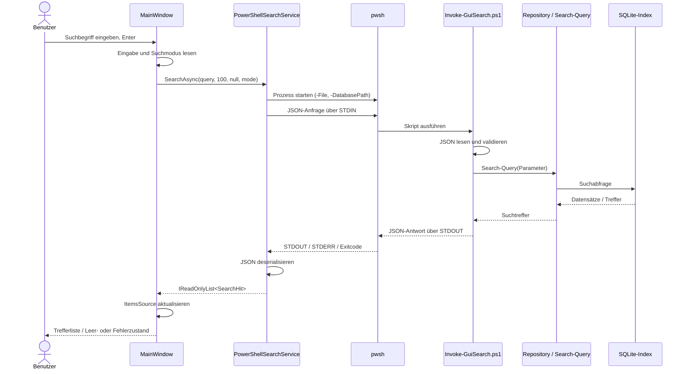

# GUI – Dokumentation der Dateisuche

## 1. Zweck und Überblick

Die GUI der Powershellsuchmaschine ist eine visuelle Oberfläche für den Endnutzer. Sie ermöglicht die Eingabe eines gesuchten Dateinamen oder -inhalt und gibt diese dementsprechend aus.

> Die Oberfläche basiert auf **Avalonia UI 11.3.23** und **.NET 10**. Die PowerShell-Schnittstelle setzt **PowerShell 7.2 oder höher** und **.NET 10 oder höher** voraus.

### Kernfunktionen

* Suche nach Dateinamen, Dateiinhalt oder beidem

* Vorschau von Suchtreffern

* Hervorhebung markierter Trefferbereiche in der Vorschau

* Startbildschirm mit Status- und Fortschrittsanzeige während des initialen Crawling-/Indexierungsvorgangs

* Plattformübergreifbarkeit durch Avalonia

***

## 2. Aufbau der GUI

Die Anwendung besteht aus zwei sichtbaren Fenstern: dem Start-/Ladefenster und dem Hauptfenster. Das Hauptfenster hat eine Mindestgröße von 650 × 450 Pixeln. Das Splash-Fenster ist 605 × 210 Pixel groß. Das Design der UI nutzt das Konzept des Minimalismus und dem Keyboardfirst-Design als Ansatz
### 2.1 Startfenster (Splash Screen)


Beim Start wird zunächst `SplashScreenWindow` angezeigt. Das Fenster enthält:

* das Anwendungslogo,

* eine Statusmeldung,

* einen Fortschrittsbalken.

Währenddessen führt `App.InitializeApplicationAsync` den initialen Scan in einem Hintergrundtask aus. Der Scan wird durch einen separaten `pwsh`-Prozess und das Modul `Crawler.psm1` ausgeführt. Fortschrittsmeldungen des PowerShell-Prozesses werden ausgewertet und an das Splash-Fenster weitergegeben.

| Element            | Zweck                                                  |
| ------------------ | ------------------------------------------------------ |
| Logo               | Visuelle Kennzeichnung der Anwendung                   |
| Statusmeldung      | Zeigt den aktuellen Initialisierungsschritt            |
| Fortschrittsbalken | Zeigt einen unbestimmten oder prozentualen Fortschritt |

Nach Abschluss des Scans wird das Hauptfenster geöffnet. Tritt während der Anwendungsinitialisierung eine Exception auf, wird stattdessen ein einfaches Fehlerfenster angezeigt.

### 2.2 Hauptfenster


Das Hauptfenster (`MainWindow`) ist das zentrale Suchinterface.

| UI-Element         | Funktion                             | Implementierungsdetails                                |
| ------------------ | ------------------------------------ | ------------------------------------------------------ |
| Begrüßung          | Persönliche Begrüßung                | Verwendet `Environment.UserName`                       |
| Trefferzähler      | Zeigt die Anzahl gefundener Dateien  | **Work in Progress**                                   |
| Suchfeld           | Eingabe des Suchbegriffs             | Enter startet die Suche                                |
| Filterbutton       | Auswahl des Suchmodus                | Menüeinträge „Nach Name“, „Nach Inhalt“, „Nach Beidem“ |
| Einstellungsbutton | Öffnet ein Menü                      | Einträge sind aktuell Platzhalter                      |
| Ergebnisliste      | Darstellung der Suchtreffer          | `ListBox` mit `SearchHit`-DataTemplate                 |
| Tooltip            | Detailinformationen zu einem Treffer | Dateiname, Pfad, Änderungsdatum und Vorschau           |

Der Suchmodus wird über das Filtermenü geändert. Nach Auswahl eines Modus wird der Watermark-Text des Suchfeldes angepasst und unmittelbar eine neue Suche ausgelöst.

### 2.3 Ergebnisdarstellung

Ein Treffer wird in der Ergebnisliste im Format

```text
[<Trefferbereich>] Dateiname.ext — /vollständiger/pfad/Dateiname.ext
```

dargestellt. Der Präfix mit dem Trefferbereich wird nur angezeigt, wenn `MatchedIn` gesetzt ist. Im Tooltip werden zusätzlich angezeigt:

* vollständiger Dateipfad,

* Textausschnitt (`Snippet`),

* hervorgehobene Textbereiche.

***

## 3. Suchmodi und Eingaben

Die GUI verwaltet den Suchmodus als Zeichenkette in `MainWindow._currentSearchMode`.

| Interner Wert | Menübezeichnung | Bedeutung                          |
| ------------- | --------------- | ---------------------------------- |
| `FileName`    | Nach Name       | Suche im Dateinamen                |
| `Content`     | Nach Inhalt     | Suche im Dateiinhalt               |
| `Both`        | Nach Beidem     | Suche in Dateiname und Dateiinhalt |

Der initiale GUI-Modus ist `FileName`.

### 3.1 Auslösen einer Suche

Eine Suche wird im aktuellen Quellcode durch Drücken der Enter-Taste im Suchfeld ausgelöst. Die Auswahl eines Filtermenüeintrags löst ebenfalls eine Suche aus.

Ablauf:

sequenceDiagram
actor Benutzer
participant GUI as MainWindow
participant Bridge as SearchBridge
participant Service as ISearchService
participant PS as PowerShell-Prozess
participant Adapter as Invoke-GuiSearch.ps1

```
Benutzer->>GUI: Suchbegriff eingeben und Enter drücken
GUI->>GUI: SearchBox.Text auslesen

alt Suchbegriff leer oder nur Leerzeichen
    GUI->>GUI: Eingabe zurückweisen

else Suchbegriff vorhanden
    opt Suchservice noch nicht initialisiert
        GUI->>Bridge: CreateDefault()
        Bridge-->>GUI: PowerShellSearchService
    end

    GUI->>Service: SearchAsync(query, limit, extension, mode)
    Service->>PS: PowerShell-Prozess starten
    Service->>Adapter: JSON-Anfrage über STDIN
    Adapter->>Adapter: JSON auslesen und validieren
    Adapter-->>PS: Suchergebnis als JSON
    PS-->>Service: JSON über STDOUT

    alt Suche erfolgreich
        Service-->>GUI: Suchergebnisse zurückgeben
        GUI->>GUI: ResultsList aktualisieren
        GUI-->>Benutzer: Treffer anzeigen

    else Fehler bei der Suche
        Service-->>GUI: Exception / Fehlermeldung
        GUI->>GUI: Fehlertext in ResultsList eintragen
        GUI-->>Benutzer: Fehlermeldung anzeigen
    end
end
```

***

## 4. Übersicht der Parameterübergabe

Die Parameterübergabe erfolgt über mehrere Ebenen. C# startet PowerShell mit Prozessargumenten und überträgt die eigentliche Suchanfrage als JSON über **STDIN**. PowerShell schreibt die Antwort als JSON nach **STDOUT**. Fehlermeldungen werden zusätzlich über **STDERR** übertragen.

### 4.1 GUI → C#-Suchservice

Aufruf in `MainWindow.PerformSearch()`:

```csharp
_search.SearchAsync(
    query,
    limit,
    extension,
    _currentSearchMode);
```

| Parameter   | Typ                 | Aktueller GUI-Wert                | Beschreibung                                                             |
| ----------- | ------------------- | --------------------------------- | ------------------------------------------------------------------------ |
| `query`     | `string`            | Inhalt des Suchfeldes             | Suchbegriff                                                              |
| `limit`     | `int`               | `100`                             | Maximale Anzahl zurückgegebener Treffer                                  |
| `extension` | `string?`           | `null`                            | Optionaler Dateiendungsfilter; aktuell nicht über die GUI konfigurierbar |
| `mode`      | `string`            | `FileName`, `Content` oder `Both` | Suchbereich                                                              |
| `ct`        | `CancellationToken` | Standardwert                      | Optionales Abbruchsignal                                                 |

`ISearchService.SearchAsync` definiert als Standardwerte `limit = 100`, `extension = null` und `mode = "both"`. Der GUI-Aufruf überschreibt die ersten drei fachlichen Parameter explizit; der CancellationToken wird nicht mitgegeben.

### 4.2 C# → PowerShell-Prozess

`PowerShellSearchService` startet `pwsh` über `ProcessStartInfo`.

| Prozessargument           | Wert / Zweck                                        |
| ------------------------- | --------------------------------------------------- |
| `-NoProfile`              | Keine benutzerspezifischen PowerShell-Profile laden |
| `-NonInteractive`         | Nichtinteraktiven Prozess starten                   |
| `-ExecutionPolicy Bypass` | Wird unter Windows ergänzt                          |
| `-File`                   | Führt das Adapter-Skript aus                        |
| Skriptpfad                | Pfad zu `Invoke-GuiSearch.ps1`                      |
| `-DatabasePath`           | Pfad zur SQLite-Datenbank                           |

Die Standardstreams werden umgeleitet. Die Kodierung für Ein- und Ausgabe ist UTF-8 ohne BOM.

### 4.3 C# → PowerShell: JSON-Anfrage über STDIN

Die eigentlichen Suchparameter werden nicht als einzelne Kommandozeilenargumente übergeben, sondern als JSON-Objekt über `StandardInput`.

Beispiel für eine Suche nach Dateinamen:

```json
{
  "query": "bericht",
  "limit": 100,
  "extension": null,
  "literal": true,
  "mode": "filename"
}
```

| JSON-Feld   | Typ                | Beispiel          | Bedeutung                                    |
| ----------- | ------------------ | ----------------- | -------------------------------------------- |
| `query`     | String             | `"bericht"`       | Suchbegriff                                  |
| `limit`     | Integer            | `100`             | Maximale Trefferzahl                         |
| `extension` | String oder `null` | `null` / `".pdf"` | Optionaler Dateiendungsfilter                |
| `literal`   | Boolean            | `true`            | Aktiviert die literale Suche                 |
| `mode`      | String             | `"filename"`      | Suchmodus: `filename`, `content` oder `both` |

Der C#-Code normalisiert den Modus vor der Serialisierung mit `Trim().ToLowerInvariant()` und prüft, ob er einem der drei erlaubten Werte entspricht. Ein ungültiger Modus führt zu einer `SearchException`.

### 4.4 PowerShell-Adapter: Parameter und JSON-Eingabe

`Invoke-GuiSearch.ps1` definiert folgende Parameter:

| PowerShell-Parameter | Typ      | Standardwert                            | Validierung / Verwendung                                      |
| -------------------- | -------- | --------------------------------------- | ------------------------------------------------------------- |
| `Query`              | `string` | leer                                    | Suchbegriff; kann alternativ aus STDIN-JSON gelesen werden    |
| `DatabasePath`       | `string` | `data/index.sqlite3` relativ zum Skript | Pfad zum Suchindex                                            |
| `Limit`              | `int`    | `100`                                   | Attribut `ValidateRange(1, 1000)`; zusätzlich Laufzeitprüfung |
| `Extension`          | `string` | leer                                    | Optionaler Dateiendungsfilter                                 |
| `SearchMode`         | `string` | `Both`                                  | Suchmodus                                                     |

Da C# das Skript ohne `-Query` aufruft, liest der Adapter die JSON-Anfrage vollständig aus STDIN und überträgt die Felder in die PowerShell-Variablen. Für den Modus werden sowohl `mode` als auch ersatzweise `searchMode` akzeptiert. Die Werte werden auf `FileName`, `Content` oder `Both` abgebildet.

Der Adapter prüft das Limit erneut. Bei einer nichtleeren Suchanfrage muss die angegebene SQLite-Datei existieren. Anschließend wird `SqliteDateiRepository.psm1` importiert, die Datenbank initialisiert und `Search-Query` mit einem Parameter-Hashtable aufgerufen.

Ist `literal` aktiviert, wird `Literal = $true` an `Search-Query` übergeben. Bei einem passenden FTS-/Syntaxfehler versucht der Adapter – sofern nicht bereits literal gesucht wurde – einen zweiten Suchlauf mit literaler Suche.

### 4.5 PowerShell → C#: JSON-Antwort über STDOUT

Erfolgreiche Antwort:

```json
{
  "ok": true,
  "count": 1,
  "results": [
    {
      "path": "/home/user/Dokumente/bericht.pdf",
      "fileName": "bericht.pdf",
      "extension": ".pdf",
      "lastWriteUtc": "2026-10-12T08:30:00.0000000Z",
      "snippet": "Ein passender [Bericht] wurde gefunden.",
      "score": 0.95,
      "matchedIn": "Dateiname + Inhalt"
    }
  ]
}
```

Fehlerantwort:

```json
{
  "ok": false,
  "error": "Beschreibung des Fehlers",
  "results": []
}
```

| Antwortfeld | Typ     | Bedeutung                                          |
| ----------- | ------- | -------------------------------------------------- |
| `ok`        | Boolean | Kennzeichnet Erfolg (`true`) oder Fehler (`false`) |
| `count`     | Integer | Anzahl der Treffer (Erfolgsantwort)                |
| `results`   | Array   | Liste der Suchtreffer                              |
| `error`     | String  | Fehlermeldung bei `ok = false`                     |

Ein Treffer enthält:

| Trefferfeld    | C#-Eigenschaft | Typ / Bedeutung                            |
| -------------- | -------------- | ------------------------------------------ |
| `path`         | `Path`         | Vollständiger Dateipfad                    |
| `fileName`     | `FileName`     | Dateiname                                  |
| `extension`    | `Extension`    | Dateiendung                                |
| `lastWriteUtc` | `LastWriteUtc` | UTC-Zeitstempel der letzten Änderung       |
| `snippet`      | `Snippet`      | Textausschnitt mit Markierungen            |
| `score`        | `Score`        | Relevanz-/Bewertungswert                   |
| `matchedIn`    | `MatchedIn`    | Bereich, in dem der Treffer gefunden wurde |

Die JSON-Serialisierung verwendet `JsonSerializerDefaults.Web`. Dadurch werden die JSON-Feldnamen in camelCase geschrieben und beim Deserialisieren den C#-Record-Eigenschaften zugeordnet.

***

## 5. Allgemeine Ausgabe und Zustände der GUI

Die GUI stellt Suchresultate nicht als Roh-JSON dar. Die Antwort wird in `SearchHit`-Objekte deserialisiert und anschließend durch das DataTemplate der Ergebnisliste formatiert.

### 5.1 Mögliche Anzeigezustände

| Zustand                | Anzeige                                                            |
| ---------------------- | ------------------------------------------------------------------ |
| Initial                | Begrüßung, Suchfeld, Filter und leere Ergebnisliste                |
| Leere Suche            | `Bitte einen Suchbegriff eingeben.`                                |
| Treffer                | Dateiname, Pfad und Trefferbereich; Detailinformationen im Tooltip |
| Keine Treffer          | `Keine Treffer gefunden.`                                          |
| Suchfehler             | `Fehler: <Fehlermeldung>` als Listeneintrag                        |
| Start / Indexierung    | Splash Screen mit Status und Fortschritt                           |
| Initialisierungsfehler | Separates Fenster mit Startfehlermeldung                           |

### 5.2 Datenaufbereitung für die Anzeige

`SearchHit` stellt zusätzliche Anzeigeeigenschaften bereit:

* `Preview`: Fasst Leerzeichen und Zeilenumbrüche im Snippet zusammen. Ist kein Snippet vorhanden, wird „Keine Vorschau verfügbar.“ ausgegeben.

* `LastWriteText`: Wandelt den UTC-Zeitstempel in lokale Zeit um und formatiert ihn mit `ToString("g")`.

* `ToString()`: Erzeugt die kompakte Zeile für die Ergebnisliste. Wenn `MatchedIn` vorhanden ist, wird dieser Bereich vor dem Dateinamen ausgegeben.

### 5.3 Fehlerbehandlung

Fehler können auf mehreren Ebenen auftreten:

1. **GUI-Ebene:** Exceptions aus dem Suchservice werden abgefangen und als `Fehler: ...` in der Ergebnisliste dargestellt.
2. **Prozessstart:** Kann `pwsh` nicht gestartet werden, wird eine verständliche `SearchException` ausgelöst.
3. **PowerShell-Adapter:** Fehler werden als JSON mit `ok = false` und `error` ausgegeben; der Prozess beendet sich mit Exitcode `1`.
4. **Antwortformat:** Ist STDOUT kein gültiges JSON, erzeugt C# eine `SearchException`, die STDERR und STDOUT zur Diagnose enthält.
5. **Startinitialisierung:** Fehler beim Initialisieren des Crawlers bzw. der Anwendung führen zum Startfehlerfenster.

Der Suchservice liest STDOUT und STDERR parallel aus und wartet anschließend auf das Prozessende. Ein übergebener CancellationToken würde den PowerShell-Prozess bei Abbruch beenden; die aktuelle GUI übergibt jedoch keinen eigenen Token.

***

## 6. Architektur der GUI

Die Architektur trennt Darstellung, Prozesskommunikation und Suchlogik.

### 6.1 Komponenten

| Komponente              | Datei                                         | Verantwortung                                                            |
| ----------------------- | --------------------------------------------- | ------------------------------------------------------------------------ |
| Anwendungseinstieg      | `Program.cs`                                  | Erstellt und startet die Avalonia-Anwendung                              |
| App-Lifecycle           | `App.axaml.cs`                                | Zeigt Splash Screen, startet Initialisierung und öffnet das Hauptfenster |
| Splash Screen           | `SplashScreenWindow.axaml(.cs)`               | Status- und Fortschrittsanzeige                                          |
| Hauptfenster            | `MainWindow.axaml(.cs)`                       | Benutzereingaben, Suchmodus, Suchauslösung und Ergebnisanzeige           |
| Suchmodell              | `SearchBridge.cs` (`SearchHit`)               | Datenmodell und Anzeigeformatierung der Treffer                          |
| Suchservice-Abstraktion | `SearchBridge.cs` (`ISearchService`)          | Definiert den asynchronen Suchvertrag                                    |
| PowerShell-Bridge       | `SearchBridge.cs` (`PowerShellSearchService`) | Startet `pwsh`, übergibt JSON und deserialisiert die Antwort             |
| Service-Erzeugung       | `SearchBridge.cs` (`SearchBridge`)            | Findet Adapter-Skript und Datenbankpfad                                  |
| PowerShell-GUI-Adapter  | `Invoke-GuiSearch.ps1`                        | Validiert Eingaben, ruft Repository/Suchlogik auf und erzeugt JSON       |
| Highlight-Konverter     | `HighlightConverter.cs`                       | Markiert Trefferbereiche im Tooltip                                      |

### 6.2 Architekturdiagramm 

```mermaid
flowchart LR
    U[Benutzer] --> Main

    subgraph GUI["Avalonia GUI · .NET 10"]
        Main["MainWindow<br/>Eingabe & Ergebnisliste"]
        Splash["SplashScreenWindow<br/>Status & Fortschritt"]
        Bridge["SearchBridge<br/>Service-Erzeugung"]
        Contract["ISearchService"]
        PSService["PowerShellSearchService<br/>Prozess & JSON"]
        Hit["SearchHit<br/>Treffermodell"]
        Highlight["HighlightConverter"]
        Main --> Bridge
        Bridge --> Contract
        Contract -. Implementierung .-> PSService
        Main -->|SearchAsync(...)| Contract
        PSService --> Hit
        Hit --> Main
        Main --> Highlight
    end

    subgraph PS["PowerShell"]
        Pwsh["pwsh-Prozess"]
        Adapter["Invoke-GuiSearch.ps1<br/>GUI-Adapter"]
        Repository["SqliteDateiRepository.psm1"]
        Search["Suchlogik<br/>Search-Query"]
        Crawler["Crawler.psm1"]
        Pwsh --> Adapter
        Adapter --> Repository
        Repository --> Search
        Pwsh --> Crawler
    end

    DB[("SQLite-Suchindex<br/>index.sqlite3")]
    U --> Main
    PSService -->|Prozessargumente| Pwsh
    PSService -->|JSON via STDIN| Adapter
    Adapter -->|JSON via STDOUT| PSService
    Search -->|lesen| DB
    Crawler -->|Index aktualisieren| DB
    Splash -->|Startscan · separater Prozess| Pwsh
    Main -->|Trefferliste| U
```

**Einordnung:** Der initiale Crawler-Scan ist ein eigener Startpfad und nicht Teil des normalen Suchaufrufs. Die Suche nutzt anschließend den von der PowerShell-Suchlogik bereitgestellten SQLite-Index.

### 6.3 Sequenzdiagramm einer Suche



### 6.4 Start- und Initialisierungsablauf 

```mermaid
flowchart TD
    Start([Program.Main]) --> App[Avalonia-App starten]
    App --> Splash[SplashScreenWindow anzeigen]
    Splash --> Init[Initialisierung im Hintergrund starten]
    Init --> Find[Projektwurzel und Crawler.psm1 suchen]
    Find --> Check{Crawler-Modul vorhanden?}
    Check -->|Ja| Run[pwsh mit Crawler starten]
    Run --> Scan[ScanFolder(UserProfile)]
    Scan --> Progress[Status- und Fortschrittsmeldungen auswerten]
    Progress --> Stop[Crawler-Prozess beenden]
    Check -->|Nein| Log[Fehler protokollieren]
    Stop --> Main[MainWindow erzeugen und anzeigen]
    Log --> Main
    Main --> Close[Splash Screen schließen]
    Close --> End([Anwendung bereit])
```

***

## 7. Dateistruktur und Abhängigkeiten

Für die GUI-relevanten Dateien ergibt sich folgender Ausschnitt:

```text
GUI/
├── App.axaml
├── App.axaml.cs
├── Program.cs
├── MainWindow.axaml
├── MainWindow.axaml.cs
├── SplashScreenWindow.axaml
├── SplashScreenWindow.axaml.cs
├── SearchBridge.cs
├── HighlightConverter.cs
├── Invoke-GuiSearch.ps1
├── PowerShell-Suchmaschine.ps1
└── GUIAssets/
    ├── icon.png
    ├── icon.ico
    ├── app.icns
    ├── logo.png
    ├── filterIcon.png
    └── settingsIcon.png
```

Wichtige Laufzeitabhängigkeiten:

* .NET SDK / Runtime 10

* Avalonia UI 11.3.23 inklusive Desktop- und Fluent-Theme-Paketen

* PowerShell 7.2 oder neuer (`pwsh`)

* `src/Persistence/SqliteDateiRepository.psm1`

* vorhandener SQLite-Suchindex unter `data/index.sqlite3`

* für den initialen Scan: `src/Crawler/Crawler.psm1`

Die Projektdatei bindet die GUI-Assets als Avalonia-Ressourcen ein.

***

## 8. Suchdatenfluss im Überblick

```text
Benutzer
  │
  ▼
MainWindow
  │  query, limit=100, extension=null, mode
  ▼
ISearchService.SearchAsync(...)
  │
  ▼
PowerShellSearchService
  │  startet pwsh
  │  Prozessargumente: -NoProfile -NonInteractive -File ... -DatabasePath ...
  │  STDIN: JSON-Suchanfrage
  ▼
Invoke-GuiSearch.ps1
  │  JSON lesen / validieren
  │  Repository initialisieren
  ▼
Search-Query
  │
  ▼
SQLite-Suchindex
  │
  ▼
Invoke-GuiSearch.ps1
  │  STDOUT: JSON-Ergebnis oder JSON-Fehler
  ▼
PowerShellSearchService
  │  JSON deserialisieren
  ▼
List<SearchHit>
  │
  ▼
MainWindow / ResultsList
  │
  ▼
Benutzer sieht Treffer und Tooltip
```

***

## 9. Offene Punkte

1. **Trefferzähler:** `ResultsCountText` ist im XAML vorhanden, wird in `PerformSearch()` aber nicht mit der tatsächlichen Trefferzahl aktualisiert.
2. **Gefundene Dateien öffnen:** Aktuell lassen sich nur die Ergebnisse ausgebeben. Diese sind vom Endnutzer bald aufrufbar.
3. **Tabellare Eingabe:** Die aktuelle Ausgabe soll in nächster Zeit in tabellenform sein.
4. **Icon auf allen Plattformen:** Aktuell hat Windoof nur ein Icon des Programms in der Taskleiste
5. **Customization:** Es gibt die Idee, dass der Endnutzer sich das Fenster personalisieren kann.
6. **Einstellungen:** Die Einträge „Gestalten“, „filler“ und „Die Gui ist schuld“ sind Platzhalter und haben keine implementierte Einstellungsfunktion.

***
